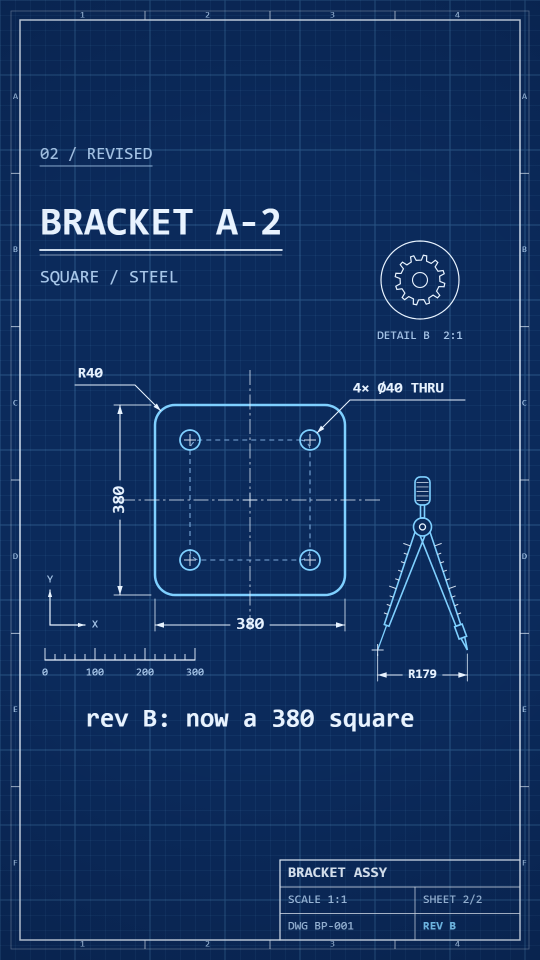

# Blueprint

An engineering blueprint. A deep blue sheet with a faint fine grid and a heavier major grid; white and pale-cyan hairlines; chain-dashed centre lines and dashed construction circles; dimension lines with arrowheads and numbers; callout leaders; a border with zone ticks and a title block in the corner; mono labels. Nothing is filled: every part is an outline, and every line is **drawn on** (a stroke reveal) in the order a draughtsman would draw it: sheet, title, part, construction, dimensions, callouts. Lines are rigid: they do not wobble.

Use it for technical subjects: a part, a system, a plan, a spec, a "revision B" story. The hero is a drafting compass drawn as outline, with dimension ticks on its legs and a live radius reading under its tips.

**Made without reference media.** The numbers below are the values chosen in `kit.js`, not measurements of a reference. The look has not had the `new-style.md` thumbs-up check-in yet.

## Palette (`BP.*`)

| key | value | use |
|---|---|---|
| `ground` / `groundD` | `#0b2a5b` / `#071d42` | the sheet (and `STYLE.paper`, `ERA_BG`) / the page background and the corner darkening |
| `white` | `#e8f3ff` | linework: dimensions, leaders, centre lines, title block, headings |
| `cyan` | `#7fd0ff` | **the subject**: the part's outline and holes, the morphing shape, the compass (`heroColor`), the revision letter. Do not spend it on decoration. |
| `mute` | `#a9c8ea` | small labels: tag, sub-heading, scale numbers, zone letters |
| `con` | `#8fbff0` | construction: dashed bolt circle and the inner offset outline |
| `gridF` / `gridM` | `rgba(127,208,255,0.12)` / `rgba(127,208,255,0.26)` | fine grid (every 30px, 1px) / major grid (every 150px, 2px) |

The corner darkening in `post()` is `rgba(3,12,32,0)` at 0.32 of the frame height from the centre to `rgba(3,12,32,0.34)` at 0.78.

## Line and texture

- Part outline 5px cyan, holes 3.5px cyan, border 3px (inner) and 1.5px (outer at 40% alpha), dimension and leader lines 2.2px, extension lines 1.8px at 85% alpha, centre lines 2px chain-dashed `[30, 7, 5, 7]` at 75% alpha, construction circles 2.2px dashed `[10, 8]`. Caps are round (butt when dashed), joins are mitred.
- **Rigid**: no wobble, no boil, no speckle. The only per-frame change is the draw-on and the parts that move.
- Every width is divided by the camera zoom (`ctx.getTransform().a`), so the lines stay hairlines under a push-in. The grid is drawn in world coordinates, so a camera moves it with the drawing.
- Nothing is filled except a ground-coloured disc under the compass hinge and knob (so the grid does not show through them) and the arrowheads.
- Text is mono (`MONO`: Consolas, Cascadia Mono, Menlo, DejaVu Sans Mono, Courier New), weight 600 for labels and 700 for the heading, 400 for small mute labels. It is typed on with a block cursor, never faded.

## Type

Heading 80px (700). Tag 34px (400) with a hairline under it, at x 80, y 310. Sub-heading 36px. Dimension numbers 34px, leader text 30px, compass reading 26px, title block 24-30px, zone letters 18px. Caption 52px (600), centred at `CX`, y 1440.

## Motion habits

- On 2s (`ones: false`): a moving part steps like a plotter.
- Draw-on easing is ease in-out (`bpEv(t, d)` = `EZ.io(ev(t, d))`), 0.3-1.4s per element. Text is typed with `ev` (linear, one character at a time).
- No springs, no zoom bumps, the camera holds still. Idle life: the compass opens and closes by about 5% (its number changes with it), a gear in a detail circle turns a step every 2s, a lamp in the title block blinks on every beat, a **hop** (`hop` 0..1) opens the compass 16% wider on a story beat.
- Morph: the bridge shape is a cyan outline with a dashed inner offset outline, chain centre lines, a centre cross and a dimension line under it whose number is read from the shape's width as it changes. The windows are rimmed in a cyan line with 16 white radial ticks.
- Tag and caption go through `DEFER` and fade out over `tc - 0.6 .. tc - 0.35` before a bridge (so they do not float over the shrinking window); the next era types its own after the window has opened.

## Frame checklist (on top of the skill's grammar/FRAME.md)

1. **No fills, no wobble.** Every shape is an outline; every line is straight or a true circle, rigid at 100%.
2. **Cyan means the subject.** Part, morph shape and compass are cyan; dimensions, leaders and the title block are white; construction is the dimmer `con` blue.
3. **Everything is drawn on, nothing pops in.** A dimension draws its extension lines, then its line, then its number; a leader draws its line, then its text. Check a frame at 1-2s into an element: it must be partly drawn.
4. **Dimensions are real numbers.** The number on a dimension is the length it measures in sheet units (Ø380 over a 380px circle; the compass reads `R` + its opening in px; the scale bar 0-300 is 300px).
5. **Dimension lines are broken around their number**, with arrowheads touching the extension lines; the number is never struck through. Text on a vertical dimension reads bottom to top.
6. **The sheet is the constant.** Border, zone ticks, title block, grid and the compass stay between eras; only the part and the title-block text (name, sheet, revision) change.
7. **Phone safe zone.** The part, its dimensions and callouts sit in x 60-940, y 250-1500. The title block and zone letters are bottom-corner decoration: `review.mjs` lists them as "under the phone UI" and still passes; keep nothing that must be read there.
8. **Hero, dimension, caption do not overlap**: the compass bottom reading is at y 1350, the caption at y 1440 (cap height starts at about 1400).
9. **Leader text sits above its horizontal segment** and ends before x 940.
10. Background life (the gear, scale bar, axis triad, border ticks, blinking lamp) is thin, white or mute, and never crosses the part's dimensions.

## Kit API (`kit.js`, on top of `kit/core.js`)

- `bpLine(P, { c, w, closed, frac, alpha, dash })` — a rigid hairline with draw-on. `bpSegs(S, { c, w, frac, alpha })` — many short segments in one stroke (ticks). `bpArrow(x, y, dx, dy, size, c)`.
- `bpText(str, x, y, size, c, { align, rot, weight, alpha, frac })` → full width. Types on with a block cursor.
- `bpGround(o)` — call at the start of every scene: fills the ground, draws the grid (`bpGrid`) and the sheet (`bpSheet`). `o`: `frame` (border draw-on 0..1), `block` (title block lines), `fill` (title block text), `name`, `sheet`, `rev`.
- `bpDim(a, b, { off, text, size, frac, c })` — a dimension: extension lines, line broken around the number, arrows, number. `off` is the sideways offset; positive is to the left of a to b (for a left-to-right line, down). `bpLeader(pts, text, { frac, size, c })` — `pts[0]` is the target, the last segment is horizontal and carries the text. `bpChain(a, b, frac)` — chain-dashed centre line. `bpCross(x, y, r, frac)`. `bpGear(cx, cy, r, teeth, rot, frac)`.
- `bpCompass(x, y, s, { frac, hop, key, al })` — the hero. (x, y) = the needle tip, s = 1 is about 350px tall and 180px open. Sets `SPARK_AT` at the hinge.
- `bpTag(str, t0)`, `bpCaption(str, t0, c?)` — through `DEFER`, typed from absolute time `t0`, faded out before a bridge (`bpFade` reads `BRIDGES`, so the piece must define it).
- `bpEv(t, d)`, `bpZ()`, `BP` palette. `STYLE`: `paper`, `ones: false`, `backdrop` (ground and grid), `window`, `blob`, `hero`, `heroColor`, `heroPts`, `post` (corner darkening).
- The demo's `scenes.js` has the piece-level helpers `bpHeading`, `bpBackground` and `bpHoles`; copy them if wanted.

## Do / don't

- **Do** order every scene as a draughtsman would draw it and gate each element with `bpEv(t, d)`.
- **Do** keep the bridge shapes outline-only and of similar proportions (circle to rounded square works; a dot into a long bar pinches).
- **Do** make dimension numbers match the geometry.
- **Don't** use fills, gradients inside shapes, shadows, wobble or `ctx.lineWidth` without the zoom division.
- **Don't** set a text in cyan; cyan is for the subject.
- **Don't** redeclare a core name (see `styles/README.md`); kit names start with `bp` or `BP`.

## Not matched (deliberate or open)

- No reference was measured; palette, grid pitch and line weights are chosen by eye. Real cyanotype blueprints are white-on-blue with a paper texture and fold marks; this look has none (a clean CAD-plot look).
- Hatching (45 degree section hatch) is not a primitive; `bpLine` plus a clip would do it.
- Text uses one font stack; a true drafting letter form (single-stroke) is not provided.
- Fixed-pitch grid does not scale with a push-in beyond the zoom division of widths; large zooms show fewer, wider cells.
- The title block and zone letters are small (18-30px) and sit under the phone UI by design.
- Camera zoom was not exercised in the demo.

## Proven on

`demo/` (8s, 9:16, 120 BPM, 24fps, 192 frames): sheet 1 draws on a round flange (outline, centre lines, bolt circle, four holes, an Ø380 dimension, a "4× Ø40 THRU" leader) with the compass hero and a rotating gear detail; at 4.0s the circle morphs into the outline of a 380 square bracket (R40 corners), sheet 2 is drawn with 380 and 380 dimensions and two leaders; the title block changes to sheet 2/2, rev B. Checked 2026-10-07:
- `tile.mjs` frames 6, 24, 40, 56, 72, 84, 90, 96, 102, 110, 120, 140, 160, 190: `deterministic: true`, 6-71 ms/frame (71 is the first frame).
- `export.mjs . --workers 2` on a copy of the demo: exit 0, `final.mp4` h264 1080x1920, 24 fps, 192 frames, 8.000s, AAC audio, 944 KB; frames written in 11.2s.
- `review.mjs`: morphs PASS (1 bridge at 4s on the 8th grid), pacing 0 hard cuts, no flat frames, story arc PASS (2/2: gift is the loudest act, p90 -14.2 against -15.2 dBFS; gift held at 0.00 cuts/s), text PASS (0 cut-off or overlapping strings; 23 strings flagged in the safe zone, all the title block and zone letters), dead beats PASS (0 stretches over 3s), loudness -14.5 LUFS, true peak -2.2 dBFS. Info: the loop returns to a blank sheet (frame diff last-to-first 7.46 against 0.24 typical).
