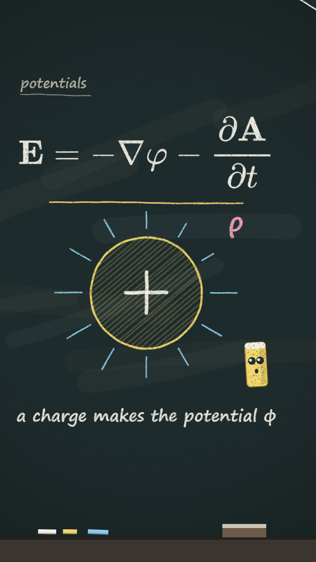

# Chalkboard

Chalk on a dark slate board. Every mark (line, hatch fill, handwriting, equation image, the hero) is drawn into a small layer, and then the layer is **eroded**: small speckle holes and short scratches are punched out of it. That is what makes it read as dry chalk and not as a thin vector line. Rubbed-out smudges and a vignette sit under everything, and a chalk tray runs along the bottom edge.

Use it when the subject is an argument worked out step by step: a derivation, a proof, a lecture, a diagram built stroke by stroke. It promises "someone is writing this now", so write things on (`frac`), never pop them in.

**Made without reference media.** The numbers below are the values chosen in `kit.js`, not measurements of a reference. The look has not had the `new-style.md` thumbs-up check-in yet.

## Palette (`CB.*`)

| key | value | use |
|---|---|---|
| `board` / `boardL` / `boardD` | `#1e2b2c` / `#273638` / `#121b1c` | the slate (and `STYLE.paper`) / lighter / darker |
| `white` | `#f2efe4` | main writing, equations, operators |
| `grey` | `#b9b8ad` | tags, small marks |
| `yellow` | `#f3d66e` | the subject of the piece (also the hero and `heroColor`) |
| `blue` / `pink` / `green` / `orange` / `red` | `#8fcbea` / `#f1a1b4` / `#a7d99f` / `#f2b27c` / `#ee8575` | one colour per quantity or idea; keep it everywhere |
| `tray` / `trayD` | `#3b3530` / `#26211d` | the chalk tray (screen bottom, inside the platform's UI cover) |

Colours are never pure white or saturated: real chalk is a little grey.

## Line and texture

- Strokes: 3–7px at 1080 wide (`w`), round caps and joins. A second thinner pass (45% alpha, 50% width, its own wobble) rides each stroke, like a line gone over twice.
- Wobble `amt` 1.4px by default; 0.8 for rays. It boils on 2s (keyed on `B`).
- Erosion: about one speckle per 38 px² (`amt` 1), 1–2.8px each at 30–95% strength, plus a scratch per ~2600 px². Fills use 1.2×, text 0.9×, equations 0.7× (thin glyph strokes need the pixels).
- Speckle is fixed by the mark's `key` (strokes also re-seed on `B`, so chalk shimmers a little; text and equations do not).
- Fills are diagonal hatching (gap 11–14px, 6px lines, alpha 0.22–0.5), never solid.
- Board: nine rubbed-out smudges at 2–4% white, a radial vignette to 38% black. A screen-wide chalk-dust speckle (700 dots, 7%) in `post()`.

## Type

Handwriting stack from the piece head (`HAND`): `"Segoe Print", "Chalkboard SE", "Bradley Hand", "Ink Free", "Comic Sans MS", cursive`. Tags 46px grey with a drawn underline; captions 56px centred at `CX`, y 1440. Equations are images from a lib (`"libs": ["mathjax"]`, `MJ.make(...)`, size ≈ 104 px/em, colour `#f2efe4`) drawn with `chImg`.

## Motion habits

- On 2s (`ones: false`). Things are **written on**: strokes with `frac` (`ev(t, d)`), text and equation images with `frac` (a left-to-right wipe).
- No springs, no zoom bumps; the camera holds still. Idle life is the hero's bob and blink, and the rays that breathe on 2s.
- Morph: the bridge shape is a chalk outline over hatching in the shape's colour; the windows are rimmed in white chalk.

## Frame checklist (on top of the skill's grammar/FRAME.md)

1. Every mark is **eroded chalk**: no clean vector line anywhere (check a full-size crop).
2. **Equations stay readable**: strokes of the thinnest glyph (the fraction bar, `∂`) are still continuous at 100%.
3. Nothing is pre-drawn: marks appear by writing on (`frac`), in the order a person would write them.
4. **One colour per quantity**, used for its label, its figure and its caption.
5. Hero, caption and tray do not overlap: hero bottom ≤ y 1330, caption at y 1440.
6. Underlines sit **below** descenders and fractions (an underline through `∂t` looks like a strike-through).
7. Fills are hatching, not flat.
8. Background life (stars, the tray, smudges) is faint and fixed; it never competes with the equation.

## Kit API (`kit.js`, on top of `kit/core.js`)

- `chLayer(w, h, key, draw, { amt, boil })` — draw into a small canvas, erode it, return it.
- `chStroke(P, { c, w, closed, frac, key, amt, alpha, erode })`, `chFill(P, c, { a, gap, angle, w, key })`.
- `chText(str, x, y, size, c, { align, weight, frac, font, key })` → width. `chImg(img, x, y, { s, frac, alpha, erode, key })` (centred; `img` from `MJ.img[id]` or `KT.img[id]`).
- `chBoard(c?)`, `chTray(y?)` — call both at the start of every scene.
- `chHero(x, y, s, { key, look: [x, y], mood: 'calm'|'wow'|'happy', hop })` — a yellow chalk stick with eyes, (x, y) = its bottom.
- `chTag(str)`, `chCaption(str, c?)` — through `DEFER`.
- `CB` palette. `STYLE`: `paper`, `ones: false`, `backdrop`, `window` (white chalk rim), `blob` (hatch + outline), `hero`, `heroColor`, `heroPts`, `post` (dust).

## Do / don't

- **Do** build every scene in the order it would be written, and gate each mark with `frac`.
- **Do** give every mark its own `key`: two marks with the same key get the same speckle.
- **Don't** call `chLayer` on a full-frame area every frame (it costs a canvas and a pass per speckle); keep layers to the mark's bounding box.
- **Don't** use `ctx.shadowBlur`, gradients or solid fills inside a chalk mark; the erosion is the texture.
- **Don't** redeclare a core name (see `styles/README.md`); kit names start with `ch` or `CB`.

## Not matched (deliberate or open)

- No reference was measured; palette, erosion density and stroke widths are chosen by eye.
- Chalk "pressure" (a stroke that is heavier where the hand pressed) is not modelled; width is constant.
- Erased-and-rewritten text (a smudge where something was wiped) is not a primitive.
- Equation images are drawn whole (left-to-right wipe); a per-stroke write-on of the glyph paths is not done. `MJ.svg[id]` holds the paths if that is wanted.
- Layers are rasterised at 1:1: a camera zoom above ~1.2 will look soft.
- The demo's equations, `E = −∇φ − ∂A/∂t` and `B = ∇×A`, were checked 2026-10-07 against Wikipedia "Lorenz gauge condition" and the Cambridge IB electromagnetism notes (`dec41.user.srcf.net/h/IB_L/electromagnetism/5_3`): both match. The rendered frames show the same glyphs as the TeX source.

## Proven on

`demo/` (6s, 9:16, 120 BPM, 24fps): a charge circle with field lines and the equation `E = −∇φ − ∂A/∂t` are written on; at 3.0s the circle morphs into a block with flow arrows and curling field lines, and `B = ∇×A` is written. `tile.mjs` prints `deterministic: true` (checked 2026-10-06). A plain browser load draws the frame.

## Equation morph (`chEq`, added 2026-10-07)
With `"libs": ["mathjax"]`, `MJ.make(id, tex, { size })` then `chEq(idA, idB, p, x, y, { frac, key, c })` draws equation A at p = 0 and equation B at p = 1. Glyphs with the same outline in both equations (matched in order by longest common subsequence) slide to their new place; the others fade. Call it with the same pair before and after the morph so the chalk speckle stays fixed. `idB = null` draws one equation (a left-to-right write-on with `frac`). Give A and B the same `size` or the matched glyphs change size. Example: `examples/maxwell-derivation`.
