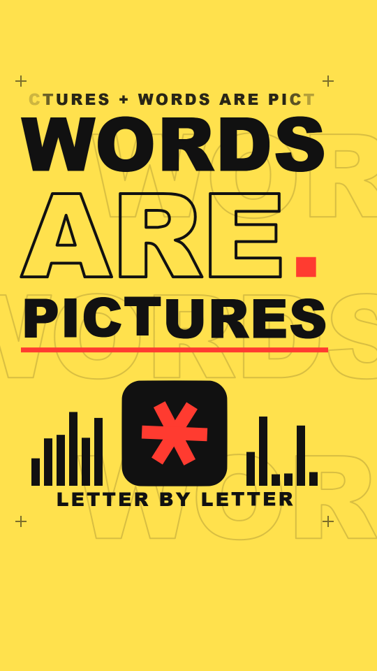

# Kinetic type

The picture is made of words and letters. Huge, heavy grotesque type fills the frame; words slam in, slide, rise out from behind their baseline, or split into letters that fly to their place and settle on a spring. Solid words sit beside outline words (stroke only). A flat bar sweeps under a word. The only "image" is a single glyph on a flat block (an asterisk that turns into a `?`, then a `!`). Everything is flat colour: no texture, no shadow, no grain, no wobble.

Use it when the idea is a claim or a phrase and the words are the content: a hook, a manifesto, a title sequence, a list of short statements. It promises "someone is hitting the beat with type", so every word arrives on a beat and nothing fades in politely.

**Made without reference media.** The numbers below are the values chosen in `kit.js`, not measurements of a reference. The look has not had the `new-style.md` thumbs-up check-in yet.

## Palette (`KTC.*`)

Two eras, one palette each: a ground, one ink, one accent.

| key | value | use |
|---|---|---|
| `yellow` | `#ffe14d` | era 1 ground (`ERA_BG[0]`) |
| `ink` | `#111111` | era 1 type, bars, ghost rows, the hero block (also the bridge shape's colour in era 1) |
| `blue` | `#2438ff` | era 2 ground (`ERA_BG[1]`) |
| `white` | `#f4f4f0` | era 2 type, bars, ghost rows, the `?` and `!`; also `STYLE.paper` (the blank sheet a morph happens on) |
| `red` | `#ff3b30` | the accent in both eras: the hero glyph (`STYLE.heroColor`), the era 2 hero block, the sweeping rule, the full stop. Nothing else is red. |

A third era needs its own ground / ink pair with the same contrast (ink on ground at least 6:1; the pairs above measure 14.5:1 for ink on yellow and 6.2:1 for off-white on blue, from the WCAG luminance formula). Do not put red on blue as type: its contrast is 1.9:1, so on blue the red is always a block with white on it.

## Line and texture

- No outline weight is "drawn": outline words use `strokeText` at `lw` 8 px (`ARE`, cap height 239 px) and 10 px (`IF`, cap 381 px), 3.3% and 2.6% of the cap height. Round joins.
- Everything else is a flat fill. No gradient, no shadow, no blur. Bars are plain rectangles 24 px wide with a 12 px gap; the rule is a 14 px bar.
- Ghost rows: the era's word repeated in outline (`lw` 4, 330 px type, alpha 0.16), three rows at y 330, 790, 1250, running off both edges.
- Registration crosses: 4 px lines, 32 px long, alpha 0.55, on the corners of the safe area (60,232) (940,232) (60,1492) (940,1492).
- The ticker: 44 px caps, alpha 0.9, between x 60 and 940, fading over 90 px at each end.

## Type

- Face: `"Arial Black", "Segoe UI Black", "Helvetica Neue", Helvetica, Impact, Arial, sans-serif` at weight 900 (`ktFont(size)`). All are local system fonts. Impact is last on purpose: it is narrower, and a weight-900 request makes some browsers fake a bold on it.
- **Set by width, not by size.** `ktFit(str, w)` returns the font size at which the word is `w` px wide, so a layout holds on any of the fallback faces. `ktStack(rows, top, gap)` stacks rows by their measured cap height. Do not write a font size or a baseline by hand for a headline.
- Headline rows: 760–880 px wide (the safe width is x 60–940, 880 px), flush left at x 60. Demo sizes (Arial Black, measured with `ktStack`, rows start at y 336, gap 64 px): `WORDS` size 214 px, cap 153; `ARE` size 333, cap 239 (set 760 wide); `PICTURES` size 155, cap 111; `WHAT` size 269, cap 193; `IF` size 530, cap 381 (set 560 wide).
- Caption: 54 px caps, 6 px letter spacing, centred at `CX` (500), baseline y 1448 (the lowest ink is y 1448 on caps, inside the safe area that ends at y 1500). Shrinks to fit 860 px.
- Hero glyph: half-size `0.62 R` of the block's half-size `R`. The asterisk is three bars (thickness 0.4 and length 2 times the glyph half-size `s`), because the font's own `*` is small and sits high.

## Motion habits

- **On 1s** (`ones: true`). Reason: the type moves on springs of k 260–320, d 14–36. `SPRING.snappy` (k 320, d 30) settles in about 0.3 s, which is 7 frames at 24 fps on 1s and about 4 distinct positions on 2s. On 2s the overshoot reads as a stutter. Nothing in this look needs 2s to hide a boil, because nothing boils. Cost: more distinct frames in the export; the demo exports in 3.8 s of frame time.
- Every word arrives on an 8th note (0.25 s) or a beat (0.5 s) and moves letter by letter with a stagger of 0.04–0.12 s (`ktLetters`).
- Three arrivals are in the demo: **slide** (`dx`, critically damped: k 320, d 36, no overshoot, so the last letter never leaves the safe width), **rise** (`dy` from behind the baseline; the `clip` rectangle ends at the baseline), **fly** (`dx`/`dy` plus `rot`, scale 1.4 to 1, underdamped k 300, d 20). A **slam** (scale 2.4 to 1 about the pivot with `sx`) is available through `ktType` / `ktLetters` but the demo does not use it (not tested here: a letter scaled that far is likely to overlap the row above and trip the text-overlap check). Playful springs (k 260, d 14) only for the hero and the full stop.
- **Order matters.** A letter that slides in from the left must start after the letters to its right (the demo sends the last letter first), or it passes through them. Letters that fly in must spread outward, never cross.
- Idle life: the asterisk spins (0.9 rad/s), the hero pulses 5% on every beat, the ghost rows drift (55–95 px/s, rows alternate direction), the ticker scrolls (130 px/s), the bars jump to new heights on every 8th, one letter at a time ripples up 9% of the cap height on the beat once a word has settled.
- Morph: the old era is seen through a window that shrinks onto the hero block, rimmed in the block's colour (16 px). On the paper, the block turns from a rounded square into a circle and its colour blends from ink to red; the asterisk shrinks and spins away, the `?` grows with a back-ease. Bridge: `tc` 4.0, `d` 0.5, `m` 0.2 (0.2 s for the morph itself).
- Camera: none. The type moves; the frame holds.

## Frame checklist (on top of the skill's grammar/FRAME.md)

1. **Real words are readable and whole.** Every word is drawn with one `fillText` / `strokeText` call per word or per letter, inside x 60–940 and y 250–1500 at rest. Check a phone-size frame: can you read every word at once?
2. **Type is the picture.** No icon, no illustration, no emoji. The hero is a glyph; the background is type, bars and rules.
3. **One accent.** Red is the hero glyph (or its block) and at most one moving rule and one full stop. Count the red objects: at most 3.
4. **Solid and outline are both present** in each era, and the outline word is the one that flies (outline letters read at any rotation).
5. **A word is set to width.** Rows are flush left and share the left edge x 60; the widest row is 880 px. No row is set by a hand-typed size.
6. **Letters never cross in flight.** Two words never overlap at rest; letters of one word never pass through another letter.
7. **Beat grid.** Every arrival starts on an 8th (0.25 s) or later; the morph centre is on the 8th grid.
8. **Background life is faint and fixed in the colour of the ink:** ghost rows at alpha 0.16, crosses, a ticker, bars. None may touch the readable words' contrast (the ghost row is under the words, so keep its stroke 4 px or thinner).
9. **Hero, caption and bars do not overlap.** Hero block bottom is y 1390; caption cap top is about y 1409; nothing below y 1500.
10. **No clean-vector artifacts of the face:** stroke text uses round joins (a miter join on a heavy face makes spikes on `A` and `R`).

## Kit API (`kit.js`, on top of `kit/core.js`)

- `KTC` palette. `ktFont(size)`, `ktFace` (the stack).
- Measuring: `ktMeasure(str, size)`, `ktCap(size)`, `ktFit(str, w)`, `ktStack(rows, top, gap)` -> `[{ s, size, cap, base, w }]`.
- `ktType(str, x, base, size, o)`: one word. `o`: `align`, `fill`, `fa` (fill alpha), `line` + `lw` (outline), `al`, `dx`, `dy`, `rot`, `sx`, `sy`, `px`, `py` (pivot), `clip: [x, y, w, h]`. Returns the width.
- `ktLetters(str, x, base, size, o, fn)`: the same word letter by letter; `fn(i, n)` returns `{ dx, dy, rot, sx, sy, al }` for letter `i`. `o.track` adds letter spacing. Each letter keeps its own kerned x.
- `ktRule(x0, x1, y, h, c, pIn, pOut)`: a flat bar swept in (`pIn`) and out (`pOut`).
- `ktGlyph(ch, x, y, s, c, rot, sx)`, `ktHero(x, y, r, { glyph, shape: 'square' | 'circle', bg, fg, sc, rot, gx })` (sets `SPARK_AT`).
- Background: `ktGhost(str, size, y, dir, speed, c, al, lw)`, `ktTicker(str, y, size, speed, c, al)`, `ktMarks(c)`, `ktBars(x, base, n, bw, gap, maxH, c, t0, seed)`, and `ktBack(c, word, tick)` which calls the first, second and third.
- `ktCaption(str, c, t0, tOut)` through `DEFER`; letters rise at `t0`, drop away at `tOut` (give it a `tOut` before a morph).
- `STYLE`: `paper` `#f4f4f0`, `ones: true`, `backdrop` (flat fill), `window` (clip, then a 16 px rim in the bridge colour), `blob` (the block, the asterisk shrinking and then the `?` growing), `hero`, `heroColor` `#ff3b30`, `heroPts` (rounded square), `post` (none).
- Needs from the piece head: `W`, `H`, `CX`, `HAND` (only `kit/board.js` reads it).

## Do / don't

- **Do** set words with `ktFit` / `ktStack`, so the layout does not depend on the face.
- **Do** draw words straight on the frame (`ktType`, `ktLetters`) so `tools/review.mjs` can read them. Only decoration goes into a bitmap.
- **Do** order a stagger so that no letter passes through another; use `Math.max(k, 0)` on a distance if an overshoot would push a letter into its neighbour.
- **Don't** let a multi-letter string cross the frame edge: the review text check fails it. Crop a giant letter by drawing it as one character, or draw it in a bitmap as the ghost rows are.
- **Don't** use `ctx.shadowBlur`, gradients, blur, grain or a drop shadow; the look is flat.
- **Don't** hide a letter below a baseline with a clip and leave its alpha at 1 before it starts: the text check still sees it. Set `al: 0` until the letter's start time.
- **Don't** redeclare a core name (see `styles/README.md`). Kit names start with `kt` or are `KTC` / `KT_GH` / `KT_M` (the bare name `KT` belongs to a library).

## Intentional crops and checks

- The only deliberately cropped type is the **ghost rows**, three rows of outline words that run off both frame edges. They are drawn from a cached bitmap (a canvas smaller than the frame), not with a text call, so the text check does not see them. They are decoration, alpha 0.16, and no real word lives only in them.
- Letters that slide in from off-screen are single characters; the text check does not treat a single character that touches the frame edge as cut off.
- No `textIgnore` is needed in `piece.json`.

## Not matched (deliberate or open)

- No reference was measured; palette, sizes, stagger and spring values are chosen by eye.
- A font that is not in the stack falls through to `Arial` or `sans-serif`; the layout holds (it is set by width) but the weight is lighter.
- Letters are not outlined into paths, so there is no true text-on-a-path, no per-glyph morph into another letter (only the hero glyph is replaced), and no variable-font axis animation.
- Transitions inside a word (tracking changes, a word that stretches to fill a box) are not primitives; `ktLetters` with a `dx` per letter covers a tracking change.
- The look is designed for 9:16 at 1080 x 1920. Other formats need their own `ktStack` tops.

## Proven on

`demo/` (8 s, 9:16, 120 BPM, 24 fps, on 1s): era 1 (ink on `#ffe14d`) sets WORDS ARE PICTURES: the letters of `WORDS` slide in last-letter first, `ARE` (outline) flies in from below with turns, `PICTURES` rises from behind its baseline, a red rule sweeps under it, a red full stop pops, the asterisk hero pops on a playful spring and spins, bars jump on every 8th. At 4.0 s the ink block turns into a red circle (the asterisk shrinks, the `?` grows). Era 2 (off-white on `#2438ff`) sets WHAT IF: `WHAT` rises, `IF` (outline) slides in and fills solid, a red rule sweeps under it, and at 6.5 s the `?` turns through its edge into a `!`.

Measured 2026-10-07:

- `tile.mjs`: `deterministic: true` (also with 8 and 20 frames across both eras and the morph).
- `export.mjs . --workers 2` on a copy: exit 0; `final.mp4` h264 1080x1920, 192 frames, 24 fps, 8.000 s, with aac audio; frames written in 3.8 s.
- `review.mjs`: cuts on grid PASS; morph on the 8th grid PASS; 0 hard cuts; flat frames none; story arc PASS (2 of 2 rules); dead beats PASS (0 stretches over 3 s); text PASS (0 cut-off or overlap, 1 safe-zone warning: the `E` of `ARE` at 0.75 s, a flying letter, 1 sampled frame); loudness -14.9 LUFS, true peak -1.3 dBFS. Info only: 0.1 s of silence before the payoff (craft.md asks for 0.5 s or more when the story has a turn); loop diff 123.8 against a typical 4.3.
- `textcheck.mjs --every 1` (every frame outside the bridge): 0 cut-off or overlap; 1 safe-zone warning (the same flying `E`, 3 frames at 0.71 to 0.79 s).
