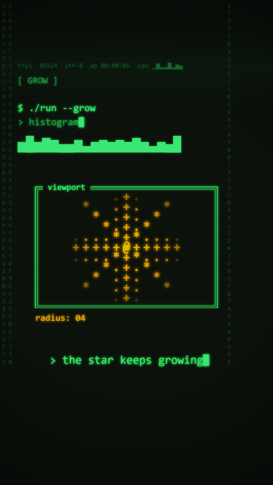

# Terminal

A command-line terminal on a CRT phosphor screen. A near-black ground, phosphor-green monospace text that is typed on character by character, a block cursor that blinks, double-line frames, block-character progress bars and charts, and one amber accent that belongs to the hero: an ASCII star made of `*` and `+`. `post()` adds faint scanlines, a soft bloom and a vignette.

Use it when the subject is a process that runs: a build, a scan, a pipeline, a model training, a log, a protocol. It promises "a machine is doing this now", so type things on, never pop them in.

**Made without reference media.** The numbers below are the values chosen in `kit.js`, not measurements of a reference. The look has not had the `new-style.md` thumbs-up check-in.

## Palette (`TM.*`)

| key | value | use |
|---|---|---|
| `ground` | `#0a0f0a` | the screen (also `STYLE.paper`) |
| `green` | `#33ff66` | main text, frames, the cursor, captions |
| `dim` | `#1f9d44` | secondary lines (`> ...` output), tags, the `rec` dot |
| `faint` | `#14612b` | background life: status line, hex rain |
| `amber` | `#ffb000` | the hero and its readout only. Never spent on decoration. |
| `panel` / `panel2` | `#0f3a1c` / `#145c2a` | the morph pane fill, era 1 and era 2 (bridge colours, 6-digit hex) |

## Line and texture

- Frames are two strokes, 3px and 2px, 9px apart (a double line, like box-drawing `╔═╗`), with a 9px glow (`shadowBlur`). The title is cut into the top edge on a ground-coloured patch. The frame wipes in downward one 40px text row at a time.
- Text is one font: `Consolas, "Cascadia Mono", "Courier New", monospace` (`TMF`). Body 40px (cell about 22px), tag 36px, caption 46px, background 24 to 26px. Weight 400, hero 700.
- Every text call has a glow: `shadowBlur` 8 in the text colour (6 for tags, 3 for the histogram, 14 for the hero, 0 for background life).
- `post()`: a bloom (a copy of the frame blurred 6px and added back at 30%), a rolling band (green at 4.5% alpha, 320px high, once every 5 s), scanlines (a 2px line at 20% black on every 4th pixel row) and a vignette (0 to 55% black).
- Background life, all dim and fixed in place: a status line at y 268 with an uptime that counts, a `cpu ▁▃▇` line next to it that changes every 0.25 s, a blinking `● rec`, and hex rain in two columns on the left and one at x 900 (rows end at y 1470).

## Motion habits

- **On 1s (`ones: true`), chosen deliberately.** Typing is one character per frame (24 characters per second). On 2s it would type 12 characters per second in pairs, and the cursor blink and the star growth would step in pairs too. Because the clock is `TT = F / FPS`, every blink is a function of `TT`: the cursor is on for 12 frames and off for 12, the star core flips between `@` and `*` every 12 frames, the CRT band moves one step per frame.
- Nothing is random per frame. Random characters come from `RNG(...)` keys that include a step number (`Math.floor(TT * 6)` for the histogram, `Math.floor(TT * 12)` for the morph cells), so they change at a set rate and the same frame always draws the same picture.
- The camera holds still. A terminal does not zoom.
- Morph: the window is rimmed in a glowing green line. The blob is a green-tinted pane with a grid of random characters (`01#%*+=:/\<>[]{}`) that dissolves in and out (density follows `sin(pi * u)`), so it reads as a pane of cells, not a blob.
- The hero grows by cells: each new ring of `+` and `*` fades in with the radius, the tips are dimmer than the core.

## Frame checklist (on top of the skill's grammar/FRAME.md)

1. **Everything is a monospace character.** No proportional text anywhere, including captions and tags.
2. **Text is typed**, left to right, with the cursor after the last character. A line that is not yet typed is not drawn at all.
3. **One cursor per frame**: `tmLog` puts it after the newest started line, solid while it types and blinking after. Do not call `tmLog` twice on the same screen unless one call has `{ cursor: false }`.
4. **Amber means the hero.** Its readout (`radius: 04`) is amber too. Nothing else is amber.
5. **Frames and the pane share the grid**: log text at x 70, size 40, 56px apart; the pane centred at x 500; the caption centred on `CX`.
6. **Glow and scanlines show at phone size** and the text still reads: check the thinnest text (the 26px status line) on the phone sheet.
7. Background life (status line, hex rain, cpu line) is fainter than every foreground line and never crosses text. The hex rain stays in x < 60 and x 900 to 940, and above y 1470.
8. Bars and charts use block characters (`█ ░ ▁▂▃▄▅▆▇`), not drawn rectangles.

## Kit API (`kit.js`, on top of `kit/core.js`)

- `tmText(str, x, y, color, { size, align, weight, glow, al })` - glowing text.
- `tmType(str, x, y, color, { t, cps, ... })` - typed text, `t` = start time, `cps` default 24. Returns the number of characters shown.
- `tmCursor(x, y, size, color, solid)` - a block cursor at a baseline position, blinking on `TT` unless `solid`.
- `tmLog(lines, x, y0, dy, size, { cursor })` - `lines = [{ t, s, c, cps, fn, y }]`: typed lines with one cursor after the newest. `fn()` returns a string drawn at once (a bar). `y` overrides the line position.
- `tmBarStr(p, cols)` - `[█████░░░░░]  42%` string.
- `tmBox(x, y, w, h, title, { frac, c, rows })` - the double-line frame, wiped in by `frac`.
- `tmHero(x, y, n, { cs, size, al })` - the amber ASCII star grown to `n` cells (`cs` = cell spacing, default 40). Sets `SPARK_AT`.
- `tmBoard()` - ground and background life. Call it first in every scene.
- `tmTag(str)`, `tmCaption(str, c?)` - through `DEFER`; the caption is typed from `E0 + 0.5` and centred by its full width.
- `tmCW(size)` - the width of one character cell, measured once per size.
- `TM` palette, `TMF` font stack, `TM_SHADES` (`▁▂▃▄▅▆▇█`). `STYLE`: `paper`, `ones: true`, `backdrop`, `window` (green rim), `blob` (character cells), `hero`, `heroColor` (amber), `heroPts`, `post` (bloom, band, scanlines, vignette).
- Needs from the piece head: `W`, `H`, `CX`. No `HAND` font.

## Do / don't

- **Do** give each log line a start time `t` and let it type.
- **Do** keep the bridge shapes of similar proportions (the demo: 640x560 into 720x480).
- **Do** keep the hero's growth inside its pane: the largest cell radius times 40px plus half a glyph must stay inside the inner frame line (5 cells is 222px against 231px in the demo).
- **Don't** use a proportional font, a drawn bar, a solid colour fill other than the morph pane, or amber for decoration.
- **Don't** use `Math.random()` or the clock. A "random" glitch needs an `RNG` key with a step number.
- **Don't** put text under y 1500 or right of x 940 (the phone UI covers it). Background hex rain stays out of those areas too.
- **Don't** redeclare a core name (see `styles/README.md`); kit names start with `tm` or `TM`.

## Not matched (deliberate or open)

- No reference was measured; palette, glow and scanline strength are chosen by eye.
- The frame is a drawn double line, not real box-drawing characters: font line heights differ and the glyphs leave gaps between rows. The corners are square strokes, not `╔ ╗` glyphs.
- No screen curvature, no chromatic aberration and no flicker. The scanlines are fixed at a 4px period and do not crawl.
- Block characters (`█ ░ ▁▂▃▄▅▆▇`) depend on the system font; on a machine with none of the three named fonts the fallback `monospace` can have different cell widths. Layout uses the measured width (`tmCW`), so text stays aligned, but a bar can be wider or narrower.
- The bloom is a blurred copy of the whole frame (`ctx.filter`), about 5 to 20 ms of the frame time. A renderer without canvas filters would skip the bloom and keep the per-text glow.
- The hero's `heroPts` is a rounded square; a hero-to-hero bridge morphs a square, not the star.

## Proven on

`demo/` (8s, 9:16, 120 BPM, 24fps, on 1s): era 1 types `$ ./run --scan sky`, loads, fills a 22-cell block bar to 100% and grows an ASCII star in a `viewport` frame; at 4.0s the 640x560 pane morphs into a 720x480 pane through a dissolving character grid; era 2 types `$ ./run --grow`, plays a 20-column block histogram, finishes with `done. radius 5 cells` and a prompt with a blinking cursor, and the star reaches radius 5. Background life: status line with uptime, cpu line, `rec` dot, hex rain. Measured 2026-10-07:

- `tile.mjs`: `deterministic: true` (frames 2, 40, 70, 94, 96, 98, 120, 150, 191 each rendered twice, second pass in reverse order); about 8 to 33 ms per frame, the first frame about 75 to 120 ms.
- `export.mjs --workers 2`: exit 0, `renders/final.mp4` h264 1080x1920, 24 fps, 192 frames, 8.000 s, with an aac track. Frames took 14.8 s (about 77 ms per frame at the end).
- `review.mjs`: cuts on grid PASS, morph on the 8th grid PASS, flat frames none, story arc PASS (2 of 2), text PASS (0 cut-off or overlap, no string in the phone UI zone), dead beats PASS (0 stretches over 3 s, median change 2.22), sound: loudest window 6.2 s at -12.9 dBFS, -14.9 LUFS integrated, true peak -3.2 dBFS. Info: loop diff last to first frame 7.38 against a typical 0.35 (the piece does not loop pixel-exactly), no silence before the payoff (0.0 s against the 0.5 to 4 s that craft.md suggests).
